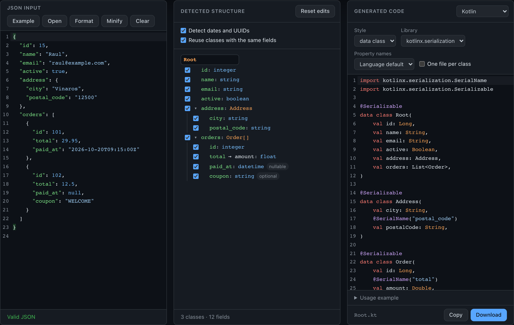

# Api2Class

Tool that turns JSON API responses into classes and typed models **without sending the JSON to any server**.

**Try it online:** [raulesteveza.github.io/tools/Api2Class](https://raulesteveza.github.io/tools/Api2Class/)

<p align="center">
  <a href="https://raulesteveza.github.io/tools/Api2Class/">
    
  </a>
</p>

## What it is for

When an application talks to an API, someone has to write the models that match its responses: one class per object, the right type for each field, lists, nested objects, fields that sometimes are not there... Doing it by hand is slow and easy to get wrong.

Api2Class does it from a real response:

```text
Paste the JSON  →  Understand the structure detected  →  Customize it  →  Generate, copy or download
```

```json
{
  "id": 15,
  "name": "Raul",
  "address": { "city": "Villaluna", "postal_code": "99001" },
  "orders": [{ "id": 101, "total": 29.95 }]
}
```

```text
Root
├── id: integer
├── name: string
├── address: Address
│   ├── city: string
│   └── postal_code: string
└── orders: Order[]
    ├── id: integer
    └── total: float
```

## Philosophy

- **The structure comes before the code.** The detected model is shown as a tree and can be edited, so it is clear what was found and the code says what you decided.
- **Doubtful types are not guessed.** A field with values of different types is left open (`any`), one that is only ever `null` stays `null`, and an empty array or object says nothing about its contents; all of them are flagged for review, with how many values of each type were found.
- **The generated code works.** Every language and style is tested with real inputs: the code reads the JSON and writes it back unchanged (see [Shared behavior](#shared-behavior)).
- **Data never leaves the device.** There is no server: the JSON is analyzed in the browser and the code is generated there. The pasted JSON and the edits are not saved anywhere, not even in the browser.

## What it does

### Read the JSON

- Paste it, open a `.json` file or drop it on the editor. Format and minify it without changing any value.
- Strict validation that says what was expected and where: `Line 3, column 3 · Expected "," or "}" after "email"`, with hints for the usual mistakes when copying a response (single quotes, comments, trailing commas, leading zeros).
- Numbers keep how they were written, so `29.0` is a float and `29` an integer.

### Detect the structure

| Detected | Example |
|---|---|
| Types | `string`, `integer`, `float`, `boolean`, `null`, objects and arrays |
| Dates, date-times and UUIDs (can be turned off) | `"1990-05-17"` → `date`, `"2026-10-20T09:15:00Z"` → `datetime` |
| Nested objects | `address: {...}` → class `Address` |
| Arrays of objects, named in singular | `orders: [{...}]` → `Order[]`, `categories` → `Category` |
| Optional fields | Missing in some objects of an array (every item is analyzed, not only the first) |
| Nullable fields | `null` in some objects and a value in others |
| Integers and floats mixed | `float` |
| Values of different types | `any`, with counts: `integer ×2, string ×1` |
| Objects with the same fields (can be turned off) | `billing_address` + `shipping_address` → one `Address` class |
| Repeated class names | `address` inside `company` → `CompanyAddress` |

### Customize it

In the tree, every field can be included or excluded, and edited: property name, type (including a generic map instead of a class), optional and nullable. Classes and the root model can be renamed. Classes that nothing uses any more disappear from the code, and edits are kept while the JSON changes.

Property names follow each language's convention, or the one you choose: camelCase, snake_case, PascalCase or as in the JSON. When a name differs from its JSON key, the code maps it (`@JsonProperty`, `@SerialName`, `CodingKeys`, `json:"..."` tags...). Reserved words and invalid names are fixed and listed: `class` → `class_`, `2fa` → `field_2fa`.

### Generate the code

| Language | Styles and libraries |
|---|---|
| **Python** | dataclass and plain class (with `from_dict` / `to_dict`), Pydantic v2 |
| **Java** | POJO, record, Lombok · Jackson, Gson or no annotations |
| **TypeScript** | interface, type, Zod 4 |
| **C#** | class, record · System.Text.Json or Newtonsoft.Json |
| **Kotlin** | data class · kotlinx.serialization, Gson, Moshi |
| **Dart** | class with `fromJson` / `toJson` (and `copyWith`), json_serializable, freezed |
| **Swift** | `Codable` structs with `CodingKeys` |
| **Go** | structs with `json` tags |
| **PHP** | PHP 8.1 readonly classes with `fromArray` / `toArray` |
| **Rust** | structs with serde |
| **Scala 3** | case classes deriving circe codecs |
| **JSON Schema** | draft 2020-12 |
| **Smithy** | IDL 2.0 |

Every language comes with a usage example. The code can be copied, downloaded as a file or, with one file per class, as a `.zip`.

### Interface

Three panes (JSON, structure, code) that become tabs on narrow screens, dark, light or system theme, and English or Spanish.

## Versions

| | Web | Desktop |
|---|---|---|
| Technology | React + TypeScript + Vite | Python + PySide6 |
| Runs in | The browser | Installable application (Windows, macOS, Linux) |
| Status | Published: [raulesteveza.github.io/tools/Api2Class](https://raulesteveza.github.io/tools/Api2Class/) | [Download](./desktop/README_en.md#download) (built and checked on macOS) |
| Documentation | [web/README_en.md](./web/README_en.md) | [desktop/README_en.md](./desktop/README_en.md) |

## Shared behavior

The two versions are written separately (TypeScript and Python), but **they behave the same**: the [`shared/`](./shared/README.md) folder contains the test cases that define what each part must do, from JSON validation and analysis to edits and the exact code generated for each language and style. The web and desktop tests read the same files, and the desktop generators were also compared with the web's output for every option: identical.

The expected code is checked with the real tools: Python (with Pydantic), Java (with Jackson, Gson and Lombok), Dart, Swift, PHP and Rust (with serde) read each sample JSON and write it back unchanged, TypeScript passes `tsc --strict`, Zod accepts each input and the JSON Schemas validate it. C#, Kotlin, Go and Scala follow each language's documented behavior but have not been compiled yet.

## Repository structure

```
web/                     Web version (React + TypeScript + Vite)
  src/core/              Logic without UI: JSON parser, analysis, model, edits, names, warnings
  src/core/generators/   One folder per language
  src/components/        React interface
desktop/                 Desktop version (Python + PySide6)
  api2class/core/        Same logic as web/src/core/, in Python
  api2class/ui/          PySide6 interface
shared/                  Behavior common to both versions
  test-cases/            JSON test cases and expected generated code
docs/                    Images
```

## Suggestions

Ideas for improvements, bugs or a language you would like Api2Class to support: write to [contact.raulesteveza@gmail.com](mailto:contact.raulesteveza@gmail.com).

## Developer

**Raul Estevez**

- [Personal Website](https://raulesteveza.github.io/)
- [LinkedIn Profile](https://www.linkedin.com/in/raulesteveza/)

## License

[MIT](./LICENSE)

[Back to main README](./README.md)
